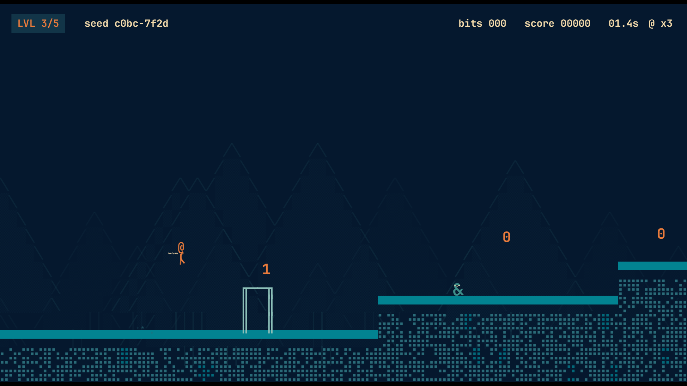

# Glyphrun



A retro platformer made entirely of text, running natively in the Omarchy shell. Every glyph takes its colour from your current Omarchy theme, and the whole game changes the moment you switch themes.

You are `@`, a developer with one ticket: change a button colour and ship it to production. Between you and the Submit button stand five levels of bugs, zombie processes, memory leaks and fork bombs, and a final boss.

## Features

- **Wears your theme.** Terrain, enemies, the HUD and the background are all drawn from your Omarchy theme's palette, and follow it live when you switch.
- **Endless levels.** Every run is generated from a seed: 20 terrains, 20 backgrounds, and layouts that are proven beatable before you ever see them. Over four billion different runs.
- **Daily seed.** Everyone plays the same run each UTC day. Unlimited tries, your best result counts, a streak for every day you play, and a one-line result to share and compare in [Daily seed results](https://github.com/smetak13/glyphrun/discussions/1).
- **Seeds to share.** Copy the seed of any run and send it to a friend to race the same levels.
- **11 enemies and traps, 4 weapons and a boss.** Stomp bugs, dodge cron jobs, throw a rubber duck or call Claude for help. High scores, fastest runs, and original music and sound effects.

## Install

```sh
omarchy plugin add https://github.com/smetak13/glyphrun.git --enable
```

Click the `@` in the bar to open and close the game window.

To remove it:

```sh
omarchy plugin remove smetak13.glyphrun
```

## Controls

| Keys | Action |
|---|---|
| `←` `→` | move |
| `Space` `↑` | jump (hold for higher) |
| `Shift` | run (hold) |
| `X` | fire (with a weapon) |
| `P` | pause |
| `Esc` | menu |

## Under the hood

- **Native to the shell.** A Quickshell plugin in Qt Quick (QML): it runs inside the Omarchy shell's own process. No browser, no Electron, no terminal emulator, no dependencies beyond Omarchy.
- **Every glyph is a Qt Quick `Text` item** in JetBrains Mono Nerd Font, positioned each frame from the game state. Terrain is drawn on a grid of half-tile cells with each glyph stretched to fill its cell, and static layers are cached as textures.
- **Pure JavaScript logic.** Physics, level generation, enemies and scoring are plain ES modules with no Qt imports, so the same code runs in the shell and in `node --test`. QML only draws, reads keys and calls the logic.
- **Deterministic.** A seeded random generator with a separate sub-stream for each feature: the same seed always gives the same levels, enemies, look and weapon, on every machine.
- **Fixed-step physics**, independent of the frame rate, so the game plays the same at 60 Hz and 144 Hz and the level validator can simulate a run exactly.
- **Generated and validated levels.** Levels are assembled from chunks, then a validator simulates the hero to prove each one can be finished without running or a weapon before it is offered.
- **Synthesised audio.** The music and sound effects are written as code in a small synth (`scripts/audio/`) and rendered to files, deterministically.
- **Offline.** The daily seed is computed from the date; nothing is ever sent anywhere.
- **Light when closed.** The game stays loaded in the bar, but audio is only created while its window is open.

## Development

- `scripts/run-dev.sh` runs the game in a temporary Quickshell window, without installing it. Closing the window quits. During play it has dev keys: H hits the hero, K plays a kill, L skips to the next level, B jumps to the boss, V shows the victory screen, and W arms the hero with the seed's weapon, then switches to the next weapon on each press.
- `scripts/link-dev.sh` symlinks this repository to `~/.config/omarchy/plugins/smetak13.glyphrun`, so the shell loads the working copy. Then enable it with `omarchy plugin enable smetak13.glyphrun`. After changing QML, restart the shell with `omarchy restart shell`.
- `scripts/check.sh` validates the manifest, runs the tests with `node --test`, and loads every logic module in Qt's QML engine (`qml6`), whose JavaScript is older than Node's.
- `node scripts/pass-rate.mjs [seeds]` generates every level for many seeds (200 by default) and reports how many pass the validator on the first attempt, after retries or only with the fallback layout, and which rules failed.
- `node scripts/generate-audio.mjs` regenerates the music and sound effects in `assets/audio/` from the synth in `scripts/audio/`. It needs `ffmpeg`; the output is deterministic.

The design is in [docs/SPEC.md](docs/SPEC.md), the task list in [docs/IMPLEMENTATION.md](docs/IMPLEMENTATION.md) and what comes later in [ROADMAP.md](ROADMAP.md).

## License

MIT
